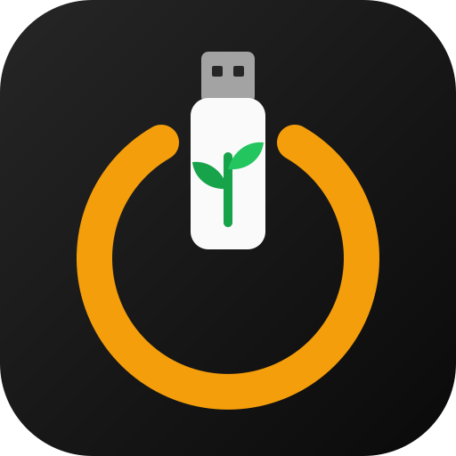
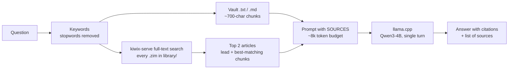

<!--
  TEMPLATE: replace every {{PLACEHOLDER}} with your own values, then delete this comment.
  Find them all with:  grep -n "{{" README.md BUILD.md
-->

<p align="center">
  
</p>

<h1 align="center">E.D.E.N.</h1>

<p align="center"><b>Emergency Drive for Everything Needed</b></p>

<p align="center">
  <i>The garden you carry for the day everything else is gone.</i><br><br>
  <b>An offline AI assistant, medical encyclopedia, encrypted vault and rescue OS on one {{USB_SIZE}}&nbsp;GB USB stick.</b><br>
  Plug it into any Windows, Linux or Mac computer. No internet, no install, no account.
</p>

<p align="center"><a href="BUILD.md"><b>➜ Build your own on a blank USB stick (16 GB minimum)</b></a><br>
  Using a coding agent? Point it at <a href="AGENTS.md"><code>AGENTS.md</code></a>.</p>

<p align="center">
  
  
  
  
</p>

---

> **The name.** In the Fallout games, a GECK (Garden of Eden Creation Kit) is the device that
> rebuilds a living world after the bombs. EDEN is the real-world, pocket-sized version: one USB
> stick with everything needed to get going again — knowledge, advice, your own records and a working
> computer.

## Why

Most of what we rely on in a bad moment lives in the cloud: search, AI assistants, medical
information, scanned documents, emergency contacts. On the worst day (a power or network
outage, a natural disaster, a lost phone, travel without data, a locked account) those are
the first things to disappear.

This kit is a pocket-sized fallback that still works when everything else doesn't:

| Situation | What the kit gives you |
|---|---|
| No internet, need medical information | ~2 GB of Wikipedia's medical articles (WikiMed), with images, fully searchable |
| Need advice, not just articles | A local AI that **looks things up before it answers** and names its sources |
| Phone lost or dead | Emergency contacts, blood group, allergies, medicines, insurance and ID numbers in an encrypted vault, readable on any borrowed computer |
| Computer won't boot / compromised | Boot Ubuntu, Tails (amnesic, private), SystemRescue or the Windows installer from the same stick |
| Privacy | Nothing leaves the machine: the AI runs locally, and the vault is noise without the passphrase |

It costs one USB stick and an evening, it has no subscriptions, and it doesn't age much: the
models, encyclopedia and tools are plain files that can be refreshed with one script.

## What's on the stick

```
USB stick, {{USB_SIZE}} GB
├── EDEN-1-BOOT   (exFAT, {{VENTOY_GB}} GB)  bootable ISOs: Ubuntu 24.04, Tails 7, SystemRescue 13, Windows 10
├── VTOYEFI                        Ventoy boot loader (never touch)
├── EDEN-2-KIT    (NTFS, {{KIT_GB}} GB)   the kit: launchers, models, encyclopedia, vault   <- this repo's kit/
└── EDEN-3-SPARE  (NTFS, {{SPARE_GB}} GB)   backups (optional)
```

| Component | Version | Size | Role |
|---|---|---|---|
| [llama.cpp](https://github.com/ggml-org/llama.cpp) | b11392 | 6 builds | Runs the models: Windows CPU + Vulkan, Linux CPU + Vulkan, macOS Apple Silicon + Intel |
| Qwen3-4B Q4_K_M | GGUF | 2.3 GB | Main model, good answers on ~6 GB RAM |
| Qwen2.5-1.5B-Instruct Q4_K_M | GGUF | 1.0 GB | Fallback for old 4 GB machines |
| [Kiwix](https://kiwix.org) kiwix-serve | 3.8.1 | small | Serves `.zim` encyclopedias locally with full-text search |
| WikiMed (wikipedia_en_medicine_maxi) | 2026-04 | 2.1 GB | Offline medical Wikipedia with images |
| [VeraCrypt](https://veracrypt.io) | 1.26.29 | portable + Linux + macOS (FUSE-T) | 4 GB encrypted vault (AES, SHA-512) |
| [Ventoy](https://ventoy.net) | – | – | Multi-ISO boot menu |

Drives are labelled `EDEN-<number>-<ROLE>`, and each holds an `EDEN-ID.txt` saying what belongs on it,
so nobody copies files to the wrong place by accident.

About {{FREE_GB}} GB of the EDEN-2-KIT partition is still free for more encyclopedias.

## How to use it

Open the **EDEN-2-KIT** drive and start the launcher for the computer you're on:

| OS | Start with |
|---|---|
| Windows | double-click `START-Windows.bat` |
| Linux (incl. Ubuntu/Tails booted from the stick) | `bash start.sh` |
| macOS | double-click `start-mac.command` |

The same menu appears everywhere:

```
1) Chat - Qwen3 4B          best answers, opens in the browser at 127.0.0.1:8080
2) Chat - Qwen2.5 1.5B      for old / slow computers
3) Ask a question           looks up the encyclopedias + your vault, answers, lists sources
4) Encyclopedias            browse WikiMed (and any other .zim) with pictures
5) Open / close the vault   your encrypted notes
```

**Option 3** is the heart of it. Ask *"how do I treat a burn?"* and it pulls the relevant
WikiMed article and any matching notes from your vault, then answers with citations
(output shortened):

```
Question: how do I treat a burn

- Cool the burn under cool running water for 10-20 minutes. No ice, no butter. [Burn]
- Do not pop blisters; cover loosely with a clean dressing. [Burn]
- Get medical help if the burn is large, or on the face or hands. [Burn]

Sources looked up:
  - Wikipedia Medicine: Burn
  - ...
  Check the article in option 4 before acting on medical advice.
```

To boot an operating system instead, restart with the stick plugged in, press the boot-menu
key (F12 / F9 / F11 / Esc) and pick an ISO from the Ventoy menu. The plain-language guide that
lives on the stick is in [`kit/README.txt`](kit/README.txt).

## How it was built

### 1. Partition plan
Ventoy takes the first partition for ISOs. The rest of the stick was split into an NTFS
**EDEN-2-KIT** partition, so multi-GB model files fit (FAT32 caps files at 4 GB) and Windows, Linux
and macOS can all read it, plus a spare partition.

### 2. Reproducible downloads
[`tools/fetch-usb.ps1`](tools/fetch-usb.ps1) downloads every ISO, model, encyclopedia and binary
from its official source and **checks the SHA-256** of the large files. Refreshing the kit later
means running it again.

### 3. One launcher per OS, one menu
- `START-Windows.bat`: plain batch file. Nothing to install, and it runs on any Windows.
- `start.sh`: bash for Linux and macOS. `start-mac.command` is a double-clickable wrapper.
- **Executables are shipped as `.tar.gz`** on the USB and unpacked on first run to a private
  per-user folder (`~/.cache/emergency-kit`, mode 700), because
  NTFS/exFAT mounts on Linux and macOS lose the executable bit and symlinks that llama.cpp needs.

### 4. Picking the right hardware automatically
The launcher detects a discrete GPU (NVIDIA / Radeon RX / Intel Arc) and uses the Vulkan build
**pinned to that device**. Letting llama.cpp split work across the integrated and discrete GPU
was measured at **{{SPLIT_TOKS}} tokens/s versus {{PINNED_TOKS}} tokens/s** pinned on the same machine. Without a usable
GPU it falls back to the CPU build. Apple Silicon uses Metal.

### 5. Retrieval without a vector database
Option 3 is a small retrieval-augmented generation (RAG) pipeline, about 90 lines each in
[`ask.ps1`](kit/bin/ask.ps1) (Windows, PowerShell only) and
[`ask-context.pl`](kit/bin/ask-context.pl) (Linux/macOS, Perl + curl only). These are tools
every target already has, so nothing is installed.



Design choices:
- **No embeddings.** An embedding model, index and vector store would have to be built, shipped
  and kept up to date on three OSes. Kiwix already has a full-text index inside every `.zim`, and
  personal notes are small enough for keyword scoring. Any new `.zim` copied into `library/`
  (Wikipedia, WikiHow, iFixit, survival guides…) is searched automatically, with no re-indexing.
- **Budgets keep CPUs usable.** At most 12k characters from the vault and 5k per article, so the
  prompt fits a 16k context and answers in about a minute even without a GPU.
- **Notes never leave the vault.** The prompt file containing vault text is written *inside* the
  mounted encrypted volume and deleted afterwards.
- **Cite or say so.** The system prompt makes the model cite the article or file after each point,
  and mark anything else as *(not from your sources)*.

### 6. Encrypted vault
A 4 GB VeraCrypt container (AES, SHA-512, exFAT inside) is designed to open everywhere the kit
runs: VeraCrypt Portable on Windows, `cryptsetup --type tcrypt --veracrypt` on Linux, Tails'
built-in unlocker, and VeraCrypt + FUSE-T on macOS (no kernel extension needed). The passphrase is
never stored on the stick.

## Test results

Measured on {{TEST_DATE}} by running the real scripts from the stick, with one medical question and
one question only a note in the vault could answer:

| Machine type | Backend | Medical (WikiMed) | Vault note | Time per answer |
|---|---|---|---|---|
| {{WINDOWS_MACHINE}} | {{BACKEND}} | {{PASS_OR_FAIL}} | {{PASS_OR_FAIL}} | {{SECONDS}} s |
| {{MAC_MACHINE}} | {{BACKEND}} | {{PASS_OR_FAIL}} | {{PASS_OR_FAIL}} | {{SECONDS}} s |
| {{LINUX_MACHINE}} | {{BACKEND}} | {{PASS_OR_FAIL}} | {{PASS_OR_FAIL}} | {{SECONDS}} s |

Use a machine type, not a model name (for example "desktop, discrete GPU", "laptop, CPU only").
Backend is one of: Vulkan, CPU, Metal.

Also tested: {{OTHER_TESTS}}

## Bugs worth remembering

- **A quoted drive root in batch loses its closing quote.** cmd treats the `\"` at the end of `"<drive>:\"`
  as an escaped quote, so the vault path
  silently broke and option 3 never saw the notes. Fix: pass `"%VAULT%."` and trim quotes in the script.
- **macOS purges `/tmp` after 3 days.** The unpack directory survived but was empty, so the
  launcher thought llama.cpp was installed. It now checks for the binary itself, not the folder.
- **A fixed `/tmp` path is a trap.** On a shared machine another user could pre-create
  `/tmp/emergency-kit` with a fake `llama-cli` in it. Found by an automated security review;
  binaries now unpack to a private per-user folder.
- **Small models copy examples.** The example file name in the system prompt started showing up
  as a citation in real answers. Example names were removed from the prompt.
- **An integrated + discrete GPU split is slow.** See the measurement in step 4.

## Limitations and next steps

- A 4B model can be confidently wrong. Every medical answer points back to the article to check,
  and the guide on the stick says to call emergency services first.
- Keyword search always returns *something*, so off-topic questions list unrelated articles
  (the model ignores them).
- PDFs and Word files in the vault must be saved as text before option 3 can read them.
- Not yet verified on real hardware: Ventoy boots with Secure Boot on (expect MOK enrollment
  on first boot), and opening the vault from Linux, Tails and macOS.
- Ideas: a WikiHow / survival `.zim`, a vision model for reading photos of documents, a second
  stick kept off-site.

## Repository layout

```
kit/                       what sits on the stick's EDEN-2-KIT partition (minus the big files)
  START-Windows.bat        Windows launcher and menu
  start.sh                 Linux / macOS launcher and menu
  start-mac.command        double-click wrapper for macOS
  MAKE-VAULT-Windows.bat   one-time vault creation (menu option 5 runs it when there is no vault)
  README.txt               plain-language guide for whoever finds the stick
  bin/ask.ps1              option 3 retrieval (Windows)
  bin/ask-context.pl       option 3 retrieval (Linux / macOS)
AGENTS.md                  the same build as commands + safety rules, for coding agents
BUILD.md                   step-by-step guide to building one from a blank USB stick
tools/fetch-usb.ps1        downloads + SHA-256 checks the models, ZIMs, ISOs and binaries
assets/logo.svg            logo (logo.png for places that don't take SVG)
```

Models, encyclopedias, ISOs and binaries aren't in the repo. `tools/fetch-usb.ps1` gets them:

```powershell
powershell -File tools\fetch-usb.ps1 -Ventoy <EDEN-1-BOOT drive> -Kit <EDEN-2-KIT drive>
```

## How it was made

Built {{BUILD_DATE}} by {{YOUR_NAME}}, pair-programming with **Claude Code** (Anthropic's agentic
coding tool). The agent prepared the stick, wrote the launchers and ran the tests on Windows, Linux
and macOS. {{YOUR_ROLE}}

## Credits

Built on the work of [llama.cpp](https://github.com/ggml-org/llama.cpp),
[Qwen](https://huggingface.co/Qwen), [Kiwix](https://kiwix.org) and
[WikiProject Medicine](https://en.wikipedia.org/wiki/Wikipedia:WikiProject_Medicine),
[VeraCrypt](https://veracrypt.io), [FUSE-T](https://www.fuse-t.org) and [Ventoy](https://ventoy.net).
Each keeps its own license.

> Not medical advice. In an emergency, call your local emergency number first.
